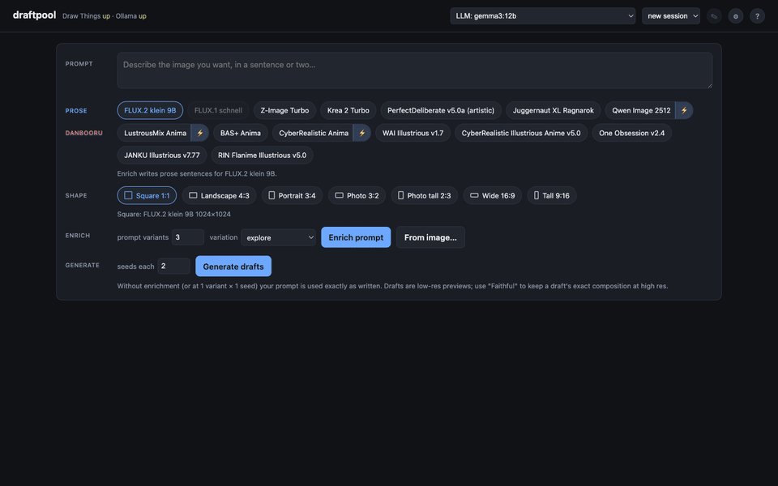

# draftpool

A self-hosted image generation studio for Apple Silicon Macs. It connects
[Draw Things](https://drawthings.ai/), which runs the image models, to
[Ollama](https://ollama.com/), which runs a local LLM that writes prompts. A
small web page connects the two. Everything runs on your own machine.

The idea: don't expect one prompt to give you the picture you had in mind.
Make a batch of cheap drafts instead, across several prompt variations, models
and seeds. Keep the ones that work and spend the slow, full-quality passes only
on those.



## Why drafts

A prompt says what you want, not what you will get. Ask for a fluffy Persian
cat on someone's lap and you can get a bright green cat held in their arms.
The only way to find out is to render it, and the same words land differently
on every model.

So the draft is the unit of work here. You try a dozen quick ones to see which
parts of your request survive, then finish the one that did. Every prompt
stays editable at every step.

## Settings are chosen for you

Draw Things exposes every setting (sampler, steps, CFG, size, LoRAs) for every
model, and each model wants different values. draftpool ships every model with
settings that have been tested, so you pick a model and a shape and the rest is
decided for you. You can still change step counts and switch the speed LoRAs
in the ⚙ dialog, and every number is in `config/models.yaml`.

## How it works

1. Type a short description, or start from an image (**From image…**), which
   a vision LLM turns into a prompt you can edit.
2. The LLM writes several varied prompts from it, also editable. Your own
   wording is kept as one of them.
3. Draw Things renders drafts for every prompt, on each model and seed you
   picked.
4. Take the good ones further: finalize, edit, upscale, animate or publish.
   [What each action does →](docs/GUIDE.md#what-each-action-does)

Every prompt, seed and setting is saved, so any image can be made again.

Nothing is instant. On an M4 Pro a draft takes 15 seconds to a minute
depending on the model, a finished image a couple of minutes, and a
two-second video about twelve.
[Full timings →](docs/GUIDE.md#how-long-things-take)

## Setup

You need an Apple Silicon Mac on macOS 13 or later. 48GB of memory runs
everything; 16GB is enough for the smaller models but not the large ones or
video. Plan on about 60GB of disk for a full set of models.

```bash
git clone https://github.com/homiak/draftpool.git
cd draftpool
./scripts/setup.sh          # tools, Python environment, upscaler
./scripts/setup.sh --llms   # also download the two Ollama models (~14GB)
```

Three steps are manual, because the script can't control the Draw Things app:

1. Install [Draw Things](https://apps.apple.com/app/id6444050820) (free, Mac
   App Store). In its settings turn on **API Server**, protocol **HTTP**, port
   **7860**. Check it again after restarting the app, as it sometimes turns
   itself off.
2. In its model manager, download at least one model (**Z-Image Turbo** is a
   good first one) and the **4x UltraSharp** upscaler under **Official
   Upscalers**.
3. Run `uv run python scripts/probe.py` to check the app can reach Draw Things.

Then start the server:

```bash
uv run uvicorn app.main:app --port 8500
```

and open http://127.0.0.1:8500.

Nothing renders without Draw Things, so every time you start draftpool, open
Draw Things too and check its **API Server** is still on.

The prompt help needs Ollama running: **Enrich**, **From image…**,
**Finalize+**, **Improve with LLM** and Publish's *from image* buttons. Without
it you can still render your own prompt. `setup.sh` starts Ollama as a
background service; if it isn't running, start it with
`brew services start ollama`.

The page header shows **Draw Things up · Ollama up** once everything is
connected.

The community models from Civitai, the image editor, the video model and
troubleshooting are covered in the [full setup guide](docs/SETUP.md).

### Your data

Your sessions, prompts and images are stored in `data/`. It's the one part of
an install that can't be rebuilt, so it's worth moving it outside the project
folder:

```bash
mkdir -p ~/draftpool-data && mv data/* ~/draftpool-data/
# then in .env:  DRAFTPOOL_DATA_DIR=/Users/you/draftpool-data
```

To update: `git pull`, then run `./scripts/setup.sh` again. The database
upgrades itself on the next start. [More on updating →](docs/SETUP.md#updating)

## Documentation

Also as a website: https://homiak.github.io/draftpool/

- [Guide](docs/GUIDE.md): what each action does, how long it takes, and how to
  get good results.
- [Deep dive](docs/DEEP-DIVE.md): edge cases and workarounds.
- [Setup](docs/SETUP.md): full install, Civitai models, data, updating,
  troubleshooting.
- [Adding a model](docs/ADDING-A-MODEL.md): checking and setting up a model
  the app doesn't include.
- [Credits](docs/CREDITS.md): the apps and models this is built on.

For developers: run the tests with `uv run pytest`. Code comments sometimes
refer to design notes and measurements (`docs/decisions/`, `research/`,
`TODO.md`). Those are kept in the maintainer's own repository and are not
published here.

## License

MIT, see [LICENSE](LICENSE). This covers the code in this repository only.
Draw Things, Ollama and every model you download have their own licenses, set
by their authors. Check a model's page before using its output commercially.
